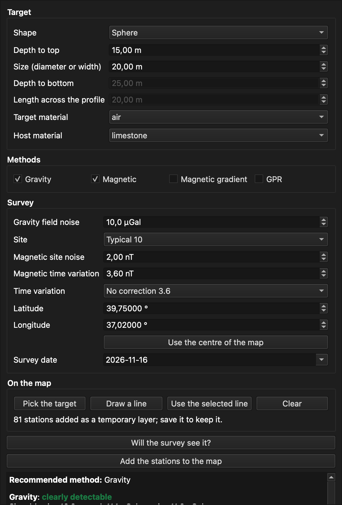

# Detectability for QGIS

**Will the survey see the target?** A QGIS plugin for the question asked before fieldwork: describe a buried target
and a survey, and it models the response, compares it with instrument and field noise, and says whether the target is
detectable, with the station spacing and the profile length that go with the answer.

It is the QGIS face of [Detectability](https://detectability.mukreminnergiz.com), an open-source tool for pre-survey
detectability, and it computes with the same library, so the numbers are the same in QGIS, on the website and in
Python.



## What it does

- **Panel.** Target (sphere, tunnel or pipe, shaft or well, room or block, wall or dyke, fault or contact), its depth
  and size, what it is made of and the host rock; the methods; the field noise. For each method: the verdict (clearly
  detectable, marginal, not detectable), signal-to-noise ratio, peak anomaly, effective noise, recommended station
  spacing and profile length, and the assumptions behind them.
- **On the map.** Click the target to take its latitude and longitude (the magnetic methods need the Earth's main
  field there, from IGRF-14). Draw the survey line with two clicks, or take a selected line feature. The panel says how
  long the line is against what the model asks for and how far it passes from the target, and the magnetic methods
  take the line's direction as the profile direction.
- **Stations.** One button adds a temporary point layer with a station every recommended spacing along the line. Each
  point carries its number, its distance along the line, the method, the verdict and the signal-to-noise ratio.
- **Processing.** The same as an algorithm, *Detectability and stations along survey lines*, for a whole layer of
  lines, batch runs and the model designer.

Methods: gravity, magnetics, magnetic vertical gradient, ground-penetrating radar. Electrical resistivity, which the
website offers, is not in the plugin: it needs a finite-element package that QGIS does not ship.

## Install

In QGIS: *Plugins → Manage and Install Plugins*, search for **Detectability**.

From a file: download the zip of a release, then *Plugins → Manage and Install Plugins → Install from ZIP*.

Open it from *Plugins → Detectability*. Nothing else needs installing: the plugin carries the library and uses the
NumPy that comes with QGIS.

## What the result means

A result is a model-based expectation under the assumptions it lists, not a guarantee. The model is a single body in
a homogeneous host under flat ground, with no regional trend; field noise is a figure you give, with stated defaults.
Signal-to-noise of 5 or more is called clearly detectable and 2 to 5 marginal: these are conventions, not physics.
The methods, their sources and the checks of each model against an independent result are on the website:
[method](https://detectability.mukreminnergiz.com/method) and
[model checks](https://detectability.mukreminnergiz.com/validation).

Distances along a line are measured in metres on a plane laid on the ground at the middle of the line, whatever
projection the project uses. The profile of the model runs across the middle of the target: a line that passes to one
side sees less than the figures say, and the panel tells you how far to the side the line is.

Give a **line spacing** (panel, or the Processing algorithm's parameter) and a compact target (sphere, shaft, block) is
assessed for gravity, magnetics and the magnetic gradient where a survey of parallel lines reads least between two of
them, taking for every position the line that reads most. The figures, the verdict and the station spacing are then
those of that line, and the result says what share of the best line it reads. It is the worst case of an ideal survey
(straight, evenly spaced lines, constant height, flat ground); a real one can lose more, and every such result says
so with its source. Left at zero, results are those of a line over the target.

## Where it has been tried

The whole plugin (load, panel, target, line, stations, Processing, unload) is run by `tests/headless_qgis.py` inside
real QGIS installations on every change:

| System | QGIS | Qt | Python | NumPy |
|---|---|---|---|---|
| Windows (official installers) | 3.34.0 | 5.15 | 3.9 | 1.24 |
| Windows (official installers) | 3.40.15 | 5.15 | 3.12 | 1.26 |
| Windows (official installers) | 3.44.15 | 5.15 | 3.12 | 2.4 |
| Windows (official installers) | 4.2.3 | 6.11 | 3.12 | 2.4 |
| Linux (official container images) | 3.34, 3.40, 3.44, 4.2 | 5.15 and 6.10 | 3.12 and 3.14 | 1.26 and 2.3 |
| macOS | 4.3 (development build) | 6.11 | 3.12 | 2.5 |

Supported: QGIS 3.34 to 4.x. The test does not look at the screen, so a layout problem on a system would not be caught
by it: please report one if you see it.

## Privacy

The plugin makes no network connection and collects nothing. Everything is computed on your machine.

## The library inside

`detectability_qgis/lib/` is a copy of the [Detectability library](https://github.com/mukremin-nergiz/detectability)
at the version named in `detectability_qgis/lib/VERSION`. It is the library's own code with two things left out,
because the plugin does not use them (the validation module with its reference files, and the resistivity module,
replaced by a stub that reports the method as not available), and one line changed so that the copy finds its
coefficient file under its new package name.

## Tests

```
python -m pip install numpy pytest
python -m pytest tests/test_core.py -q          # the calculation layer; no QGIS needed, Python 3.9 or later
python3 tests/headless_qgis.py                  # the whole plugin; run with the Python of a QGIS installation
```

## Licence and citation

BSD-3-Clause, the same as the library (see `LICENSE`). If you use it in work you publish, please cite the library:

> Nergiz, M. (2026). Detectability: Pre-survey detectability, modelled and reproducible [Computer software]. Zenodo.
> https://doi.org/10.5281/zenodo.23931815

Author: Mükremin Nergiz, Geophysical Engineer & Software Developer. Problems and suggestions:
[issues](https://github.com/mukremin-nergiz/detectability-qgis/issues).
